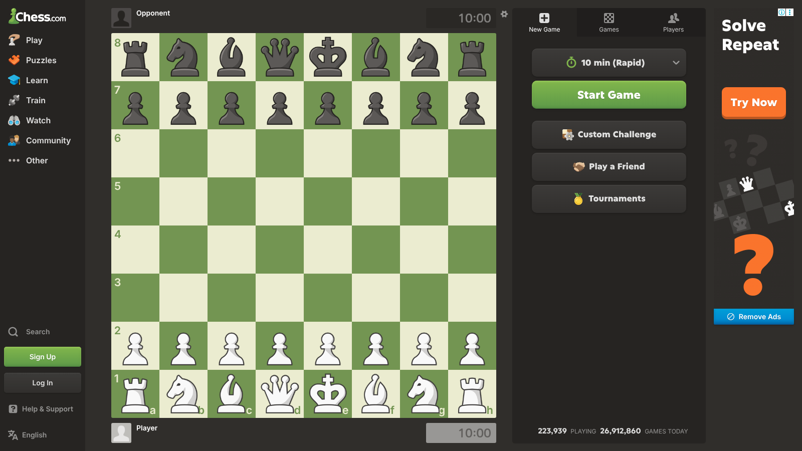
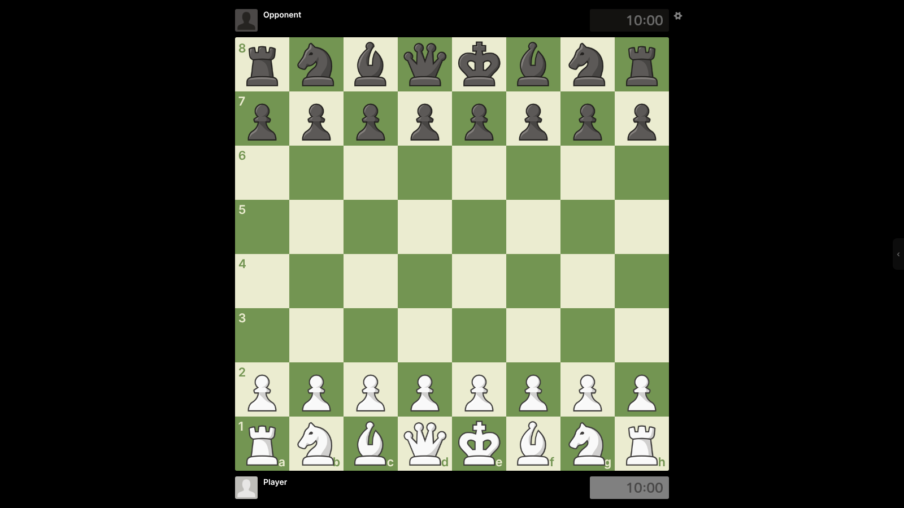
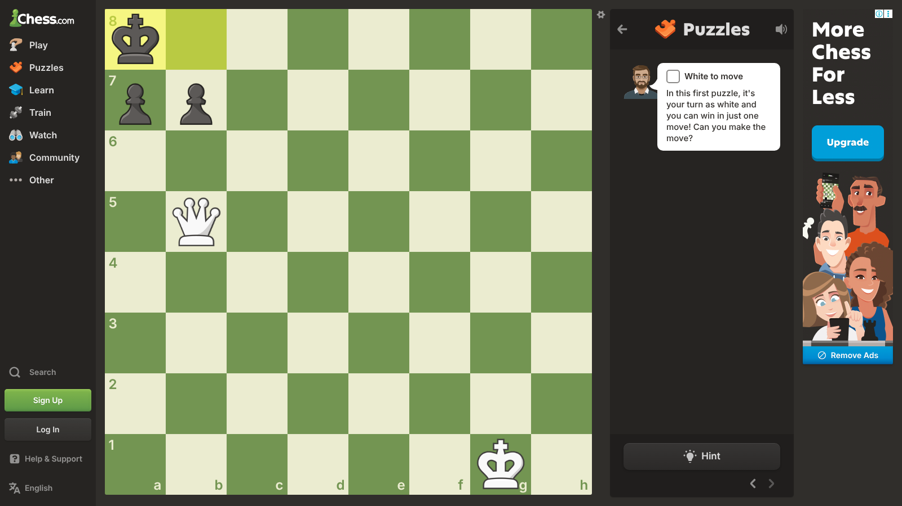
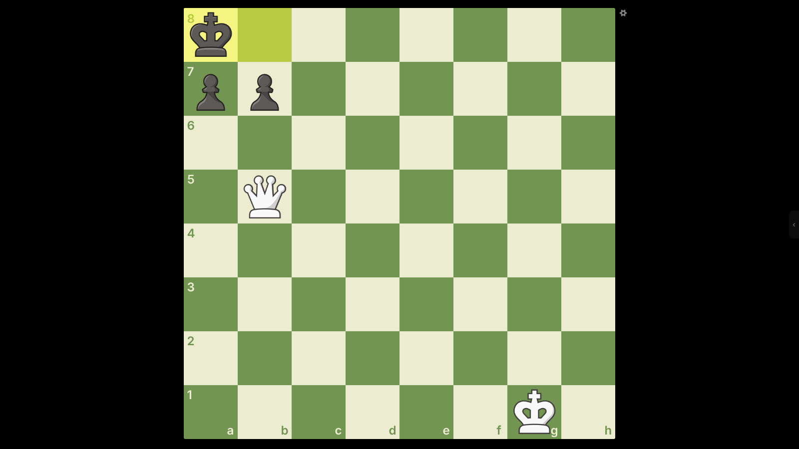
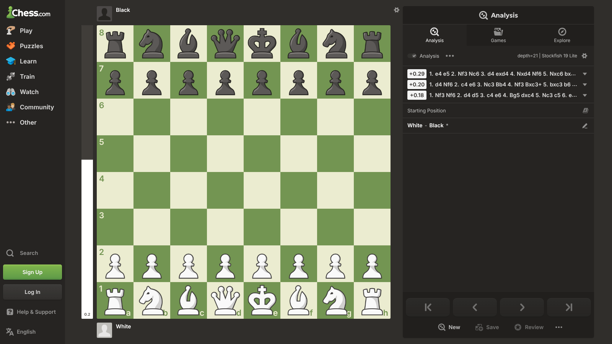
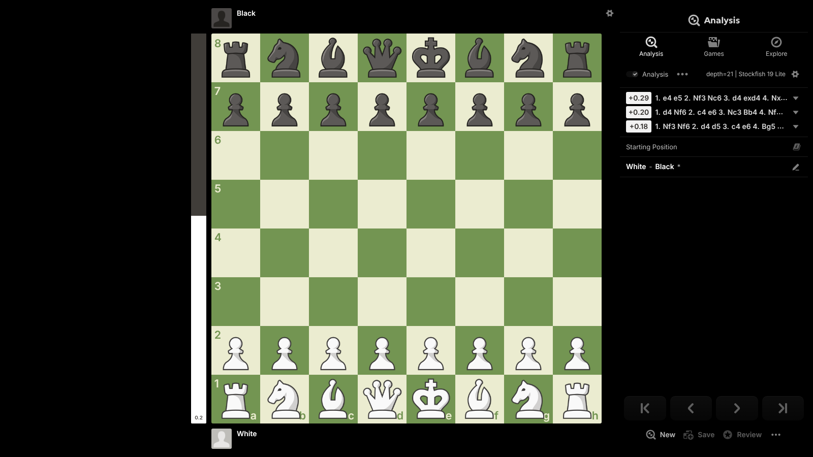
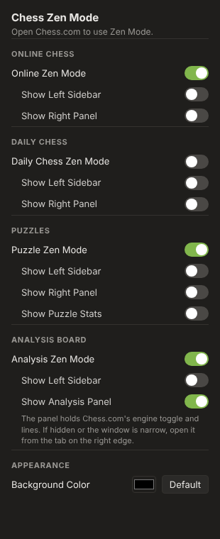

<p align="center">
  
</p>

<h1 align="center">Chess Zen Mode</h1>

<p align="center"><strong>Center the board. Hide the noise. Play and analyze Chess.com with nothing else on screen.</strong></p>

Chess Zen Mode is a small Chrome/Chromium extension that centers the Chess.com chessboard in your browser window and hides the navigation sidebar, side panel and ads around it. One toggle turns it on, another restores the normal site, without reloading the page or interrupting a game.

> **Status: v0.1.0 prototype – not released yet.** Nothing has been published on the [Releases page](https://github.com/FarmaanFJM/chess-zen-mode/releases) so far; v0.1.0 is a prototype pre-release. It has been tested automatically on logged-out guest pages only. See [Known limitations](#known-limitations-and-what-still-needs-manual-testing).

## Before and after

Online Chess (the same page, window size and moment; guest view before a game starts):

<table>
  <tr>
    <th>Original Chess.com</th>
    <th>Zen Mode</th>
  </tr>
  <tr>
    <td></td>
    <td></td>
  </tr>
</table>

The board, pieces, theme, coordinates and clocks are Chess.com's own; only the space around them changes.

<details>
<summary>Puzzles and Analysis Board</summary>

**Puzzles**

<table>
  <tr>
    <th>Original Chess.com</th>
    <th>Puzzle Zen Mode</th>
  </tr>
  <tr>
    <td></td>
    <td></td>
  </tr>
</table>

**Analysis Board** – Chess.com's own engine toggle, evaluation bar, engine lines, move list and controls stay visible beside the centered board.

<table>
  <tr>
    <th>Original Chess.com</th>
    <th>Analysis Zen Mode</th>
  </tr>
  <tr>
    <td></td>
    <td></td>
  </tr>
</table>

All screenshots were captured by [`scripts/screenshots.js`](scripts/screenshots.js) from the real extension running in Chromium on logged-out Chess.com guest pages at 1600×900. Online Chess shows the guest pre-game board. **Daily Chess screenshots are pending manual capture:** a guest only sees a placeholder page for Daily games.

</details>

## Features

- **Centered board** – centered on the whole browser window (not the space beside a sidebar), kept square, and re-centered live when you resize the window or zoom.
- **Distractions hidden** – the left navigation, the right-hand panel and ads are hidden. You can bring either panel back from the popup; the board stays centered when there is room.
- **Native board resizing** – Chess.com's own resize handle (bottom-right corner of the board) keeps working. The extension never sets a board size and never touches the size you saved on Chess.com.
- **Still reachable** – a hidden panel is not removed. A small tab on the right edge slides it back over the page, so resign, draw offers, hints and the engine toggle are always one click away.
- **Four independent modes** – each remembers its own on/off state and panel choices.
- **Persistent settings** – saved in browser extension storage, restored on the next visit and shared by all open Chess.com tabs. The layout is applied as the page loads, so it doesn't flash the original layout first.
- **Background color** – pure black by default; pick any color. Only the page background changes.
- **Fully reversible** – turning a mode off removes everything the extension added.

### Supported modes

| Mode | Pages | Notes |
| --- | --- | --- |
| **Online Chess** | `/play/online…`, `/game/<id>`, `/game/live/<id>` | Live games against other players |
| **Daily Chess** | `/game/daily/<id>` | Same layout as Online |
| **Puzzles** | `/puzzles`, `/puzzles/rated`, `/puzzles/rush`, `/puzzles/battle`, `/puzzles/problem/…`, `/puzzles/daily`, `/puzzles/learning`, `/puzzles/custom` | Optional compact stats panel (read from Chess.com's own sidebar) |
| **Analysis Board** | `/analysis…` | Chess.com's analysis panel, engine toggle and lines stay visible by default |

Every other Chess.com page (home, news, lessons, the Daily Puzzle at `/daily`, settings, …) is never touched. Game pages and the analysis board are strictly separate: only the mode for the current page type can activate.

## The extension popup



Each section has its own **Zen Mode** switch plus **Show Left Sidebar** and **Show Right Panel** switches (Analysis: **Show Analysis Panel**). Puzzles also has **Show Puzzle Stats**. Changes apply immediately to open Chess.com tabs. The screenshot shows Online, Puzzle and Analysis switched on.

| Setting | Default |
| --- | --- |
| Zen Mode (each of the four modes) | Off |
| Show Left Sidebar / Show Right Panel | Off |
| Show Analysis Panel | **On** (it holds the engine controls) |
| Show Puzzle Stats | Off |
| Background Color | `#000000` |

## Installation

Chess Zen Mode is not on the Chrome Web Store. Install it from the release ZIP:

1. Download `chess-zen-mode-v0.1.0.zip` from the [Releases page](https://github.com/FarmaanFJM/chess-zen-mode/releases) once v0.1.0 is published there. *(Until then, build it yourself, see [Development](#development), or load the repository folder directly as in the note below.)*
2. **Extract** the ZIP to a folder you will keep; Chrome runs the extension from that folder. `manifest.json` is directly inside it.
3. Open `chrome://extensions`.
4. Turn on **Developer mode** (top right).
5. Click **Load unpacked** and choose the extracted folder.
6. Reload any open Chess.com tabs.

To run straight from source, clone this repository and choose the repository root in step 5.

## Usage

1. Open a supported Chess.com page.
2. Click the extension icon and switch on the Zen Mode for that page type (Online, Daily, Puzzle or Analysis).
3. To get the normal Chess.com layout back, switch it off. Your game, puzzle or analysis keeps running; nothing reloads.
4. Use the other switches to bring back the left sidebar or the right panel, or the edge tab to peek at a hidden panel (`Esc` or a click elsewhere closes it).

You can turn on all four modes at once; each tab only follows the mode that matches its page.

## How it works

Chess Zen Mode does not replace the chessboard or implement any chess logic. Chess.com lays out its play, puzzle and analysis pages as a CSS grid on `<body>` controlled by variables such as the navigation and panel widths. The extension overrides those variables, so Chess.com's own code still sizes the board, and then makes a small measured correction so the board's center lands on the window's center. Pieces, overlays, arrows, clocks, drag and drop and the resize handle are all the original elements, untouched.

## Privacy and fair play

These statements are checked by automated tests of the source (no network or engine code, narrow permissions) and by the implementation:

- **No analysis or assistance.** The extension contains no chess engine and no move or position analysis, and never suggests, plays or automates moves. In Analysis Zen Mode the engine panel is Chess.com's own: the extension never starts, stops or configures the engine, and a disabled engine stays disabled.
- **No engine information in games.** Online and Daily game pages can only ever get their game mode, and `/analysis…` pages can only ever get Analysis Zen Mode.
- **No data leaves your browser.** There are no network requests, analytics, remote code or accounts. The only permissions are `storage` and access to `https://www.chess.com/*`.
- **What is stored.** Your switches and background color in the extension's local storage. For flash-free loading a copy of them (key `czm:last`) is also kept in Chess.com's page storage, so Chess.com's own scripts could technically read those on/off values and the color. Nothing else is stored.
- **Puzzle stats** only copy text already shown on the page.

## Compatibility

- **Tested:** Chromium (Playwright build) on Linux, desktop layout.
- **Expected to work, not tested:** Google Chrome and other Chromium-based browsers with Manifest V3 support (Chrome 105 or newer), including Edge and Brave.
- **Not supported:** Firefox and Safari.

## Known limitations and what still needs manual testing

Automated browser tests (160 executed checks passing, 1 skipped) ran only against logged-out guest pages, including the live Analysis Board with its Stockfish panel. These still need a human with an account:

- **Authenticated Online games** – ticking clocks, premoves, arrows, resign and draw offers.
- **Daily Chess** – only the guest page shell was available. Piece alignment (the one skipped test), move confirmation, conditional moves, remaining time and game actions are untested. The tab on the right edge turns amber when an offer/confirm/submit element appears in a hidden panel; this is a class-name heuristic.
- **Puzzle Rush Survival and timed Puzzle Rush (3/5 min)** – the compact stats read Chess.com's own sidebar using class names taken from its stylesheet; they are unverified, and the panel says "No stats available here" instead of guessing. It shows a single *Time* value as displayed by Chess.com.
- Real browser zoom (smaller windows were tested instead), Edge/Brave, theatre mode and the two-board Puzzle Battle layout.

Other limits: the desktop layout only (window at least 960 px wide; below that Chess.com's mobile layout is left alone); the board is centered unless a shown panel plus the board don't fit, in which case the panel moves to the edge tab; `/play/computer` and the Daily Puzzle are out of scope. Chess.com can change its pages at any time; if an element the extension relies on disappears, it does nothing rather than breaking the page.

The full results are in [docs/TEST_REPORT_v0.1.0.md](docs/TEST_REPORT_v0.1.0.md) and the draft [release notes](docs/RELEASE_NOTES_v0.1.0.md).

## Development

No build step and no runtime dependencies: the repository root is the extension. Requires Node 18+.

```text
manifest.json            Manifest V3
src/lib/                 settings, page detection, layout math, puzzle stats reader
src/content/             content script and zen.css (everything scoped to html.czm-active)
src/popup/               popup UI
test/unit/               node:test unit tests
test/e2e/run.js          Playwright browser tests (live Chess.com guest pages)
scripts/                 validate.js, package.js, screenshots.js, make-icons.py
icons/                   extension icons (generated from docs/assets/chess-zen-mode-logo.png)
docs/                    release notes, test report, screenshots
```

```sh
npm test            # unit tests
npm run validate    # manifest and file-reference checks
npm run package     # dist/chess-zen-mode-v<version>.zip + .sha256, then validates the ZIP
npm run test:e2e    # browser tests: needs Playwright, Chromium and network access
```

Load the repository root with **Load unpacked** to develop; reload the extension and the Chess.com tab after changes. `CZM_EXT_DIR=<folder> npm run test:e2e` runs the browser tests against an unpacked release ZIP. To release: run the tests, bump the version in both `manifest.json` and `package.json`, run `npm run package`, and upload the ZIP by hand. GitHub CI is not used.

## License

[MIT](LICENSE). Version 0.1.0 (see `manifest.json`).

## Disclaimer

Chess Zen Mode is an independent, unofficial extension. It is not affiliated with, endorsed by or sponsored by Chess.com. The logo (a pawn in a hot tub) is this project's own artwork and does not use Chess.com's logo. "Chess.com" is a trademark of its owner; screenshots show Chess.com's own interface only to illustrate what the extension changes.
